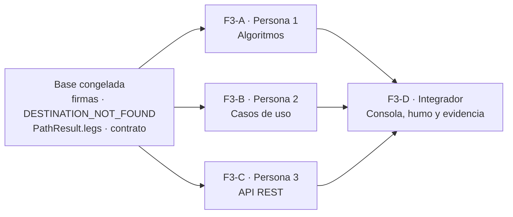

# F3 · Alternativa de atención de menor costo (Dijkstra) — 4 carriles

- **Servicio:** `routing-service` (+ pestaña en la consola web `web`, [ADR 0007](../adr/0007-consola-web-react-bff.md)) · **Estado:** 🟡 En construcción
- **Lea antes:** [05-algoritmos-dijkstra](../05-algoritmos-dijkstra.md), [02-modelo-de-grafo](../02-modelo-de-grafo.md), [03-api](../03-api.md#get-apiv1routescheapestoriginb_nortedestinationz_centrotracetrue--f3)
- **Qué hace cada integrante y cómo evitar conflictos:** [F3-sesiones.md](F3-sesiones.md)

## Valor de negocio
El operador consulta la ruta de llegada con el menor tiempo estimado y la base con técnico disponible que conviene enviar.

## Criterios de aceptación
- [ ] `/routes/cheapest` recibe origen y destino, y devuelve `path`, `legs` y `total_cost` cuando existe un camino.
- [ ] Rechaza de forma explícita los pesos que invalidan Dijkstra (`INVALID_WEIGHT`), con defensa en profundidad.
- [ ] Explica un caso donde menos tramos no es menor costo: campo `fewest_hops` y el ejemplo B_NORTE → Z_CENTRO.
- [ ] Prueba casos de ruta posible e imposible (`found=false`, sin error).
- [ ] `/attention/best` elige la base con técnico disponible de menor costo y distingue las zonas inalcanzables de las alcanzables solo por bases sin técnicos.
- [ ] Dijkstra **implementado por el equipo** (`DijkstraPathFinder`, que implementa `PathFinder`) con `heapq` y reconstrucción por `pred`.
- [ ] `trace=true` coincide con la traza de [05](../05-algoritmos-dijkstra.md).
- [ ] Pestaña **Menor costo** en la consola web para ambos roles, con la ruta resaltada en el mapa.

## Construcción: base + 4 carriles

| Carril | Qué construye | Quién | Rama |
|---|---|---|---|
| **Base** | Firmas congeladas, error `DESTINATION_NOT_FOUND`, `PathResult.legs`, contrato y este reparto | Integrador | `feature/F3-base` |
| **F3-A** | `DijkstraPathFinder` y `BreadthFirstPathFinder` (dominio puro) | Juan Pablo | `feature/F3A-algoritmos` |
| **F3-B** | `FindCheapestRoute` y `FindBestAttention` | Alexander | `feature/F3B-casos-de-uso` |
| **F3-C** | `GET /routes/cheapest`, `GET /attention/best`, inyección y mapeo de errores | Juan Andrés | `feature/F3C-api-rest` |
| **F3-D** | Pestaña **Menor costo** en la consola web, `scripts/smoke_f3.sh`, documentación y evidencia | Integrador | `feature/F3D-consola-humo` |

**Por qué no se pisan:**
1. La base deja en `main` las **firmas congeladas** (clases, constructores, `execute`/`find` y los dataclasses de resultado). `tests/unit/test_f3_interfaces.py` las vigila.
2. Cada carril prueba sin esperar a los otros: B con *fakes* de `PathFinder`, C con *fakes* de los casos de uso (`app.dependency_overrides`) y D con el BFF falso de la consola web (`services/web/tests/ui/fake-bff.ts`).
3. Cada carril toca **solo sus archivos** (tabla siguiente). A, B y C se fusionan **en cualquier orden**; D va al final.

## Propiedad de archivos

Rutas relativas a `services/routing-service/` salvo que se indique otra cosa.

| Archivo | Dueño | Regla |
|---|---|---|
| `src/routing_service/domain/cheapest_path/dijkstra.py`, `fewest_hops.py` | **F3-A** | Reemplazar el cuerpo de `find`; puede agregar funciones de apoyo en el mismo archivo |
| `tests/unit/domain/cheapest_path/**` | **F3-A** | Crear |
| `docs/05-algoritmos-dijkstra.md` (checklist "Casos que deben probarse") | **F3-A** | Marcar `[x]` |
| `src/routing_service/application/routes.py`, `attention.py` | **F3-B** | Reemplazar el cuerpo de `execute`; puede agregar funciones de apoyo en el mismo archivo |
| `tests/unit/application/test_routes.py`, `test_attention.py` | **F3-B** | Crear |
| `src/routing_service/api/routes.py`, `attention.py`, `errors.py`, `trace.py` | **F3-C** | Crear |
| `src/routing_service/api/dependencies.py`, `api/coverage.py`, `main.py` | **F3-C** | Agregar proveedores, usar el mapeo común y registrar los routers |
| `src/routing_service/infrastructure/network_gateway.py` | **F3-C** | Red incoherente → `NETWORK_UNAVAILABLE` |
| `tests/unit/api/test_routes_api.py`, `test_attention_api.py`, y una prueba nueva al final de `test_coverage_api.py` y `test_network_gateway.py` | **F3-C** | Crear o agregar |
| `docs/03-api.md` (marcar ✅ los dos endpoints) | **F3-C** | Editar solo esas dos filas |
| `services/web/**` (rutas del BFF, tipos, pestaña, resaltado en el mapa y pruebas) | **F3-D** | Crear o agregar. La consola Streamlit (`services/console`) está en retiro y no se toca |
| `scripts/smoke_f3.sh`, `docs/10-guia-prueba-manual.md`, `docs/features/F4-consola.md`, `README.md`, evidencia | **F3-D** | Crear o actualizar |
| `domain/errors.py`, `domain/results.py`, `domain/graph.py`, `domain/strategies.py`, firmas de `application/routes.py` y `attention.py`, `tests/unit/test_f3_interfaces.py` | **Congelado** | Solo con PR `contract-change` aprobado por todos |
| `core/**`, `config.py`, `pyproject.toml`, `uv.lock`, `Dockerfile`, `docker-compose*.yml`, `Makefile` | **Congelado** | Ningún carril los necesita. Sin dependencias nuevas |

**Documentación compartida:** cada carril edita **solo su fila** de la tabla "Estado de F3" en [docs/README.md](../README.md) y **solo su sección** de "Evidencia" al final de este archivo.

## Diseño (por capas)

| Capa | Archivo | Responsabilidad |
|---|---|---|
| domain | `domain/cheapest_path/dijkstra.py` | `DijkstraPathFinder`: `heapq` con tuplas `(costo, node_id)`, borrado perezoso, salida temprana, `pred` con el arco usado (para `legs`) y validación de cada peso con `validate_weight` |
| domain | `domain/cheapest_path/fewest_hops.py` | `BreadthFirstPathFinder`: BFS con `pred`, ignora pesos; `total_cost` = suma de los pesos del camino |
| application | `application/routes.py` | `FindCheapestRoute(gateway, path_finder, fewest_hops_finder)`; valida origen → destino; arma `legs`, `fewest_hops` y el `message` |
| application | `application/attention.py` | `FindBestAttention(gateway, path_finder)`; candidatas con técnico disponible, desempate costo → tramos → id |
| api | `api/routes.py`, `api/attention.py` | Endpoints, esquemas (`from`/`to` por alias), roles coordinator y operator |
| api | `api/errors.py`, `api/trace.py` | Mapeo común código → HTTP (404 inexistentes; 422 `INVALID_ORIGIN` e `INVALID_WEIGHT`) y esquema de la traza |
| infrastructure | `infrastructure/network_gateway.py` | Una red incoherente es `NETWORK_UNAVAILABLE`; un peso inválido se propaga |
| web | `server/app.ts`, `src/components/cost/` | El BFF reenvía `/routes/cheapest` y `/attention/best`; la pestaña **Menor costo** muestra la ruta entre dos puntos y la mejor base para una zona |

Decisiones:
- **Origen de `/routes/cheapest`:** cualquier nodo, no solo bases.
- **Traza:** `pop` abre cada paso; `relax`, `skip` y `stale` completan la tabla de [05](../05-algoritmos-dijkstra.md). En `/attention/best` se concatena la traza de cada base candidata con `data.base`.
- **`fewest_hops`:** BFS con predecesores; entre caminos de igual número de tramos gana el primero en orden de `id`.
- **Arreglo detectado en la revisión:** `INVALID_WEIGHT` respondía `400` en `/coverage` y una red incoherente devolvía `400 NODE_NOT_FOUND`. F3-C lo deja en `422` y `503 NETWORK_UNAVAILABLE`, como dice el contrato.

## Evidencia

### F3-A
_Pendiente._

### F3-B
_Pendiente._

### F3-C
_Pendiente._

### F3-D (integración)
_Pendiente._
