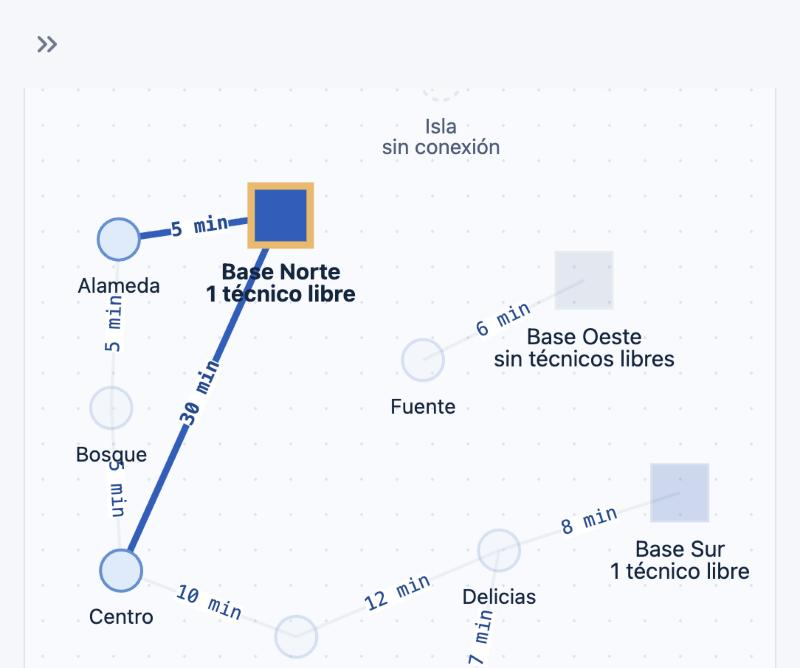
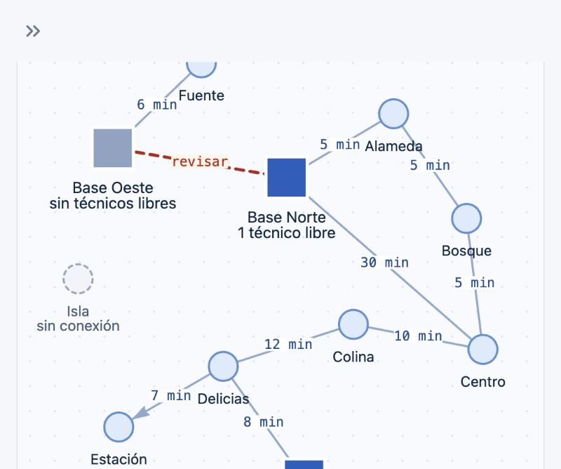
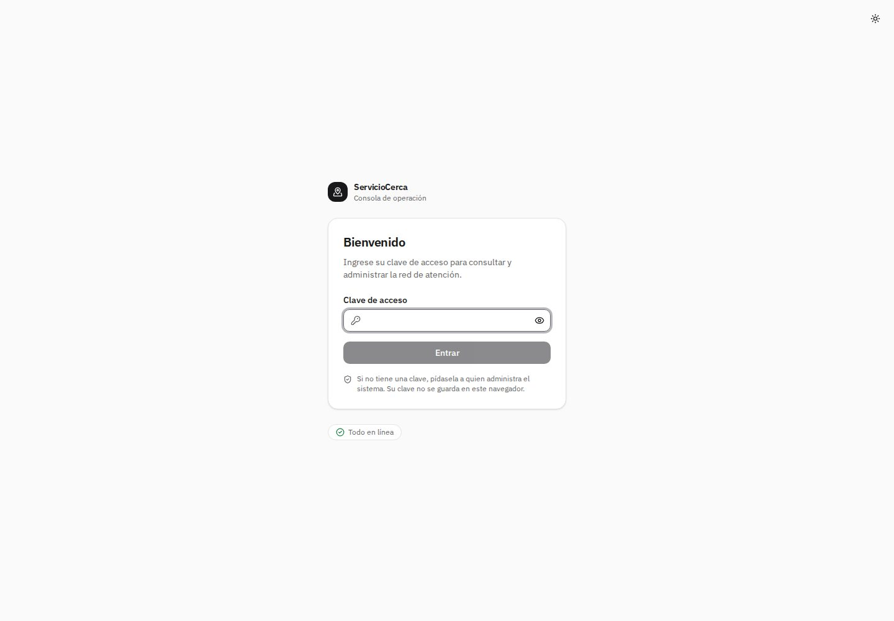
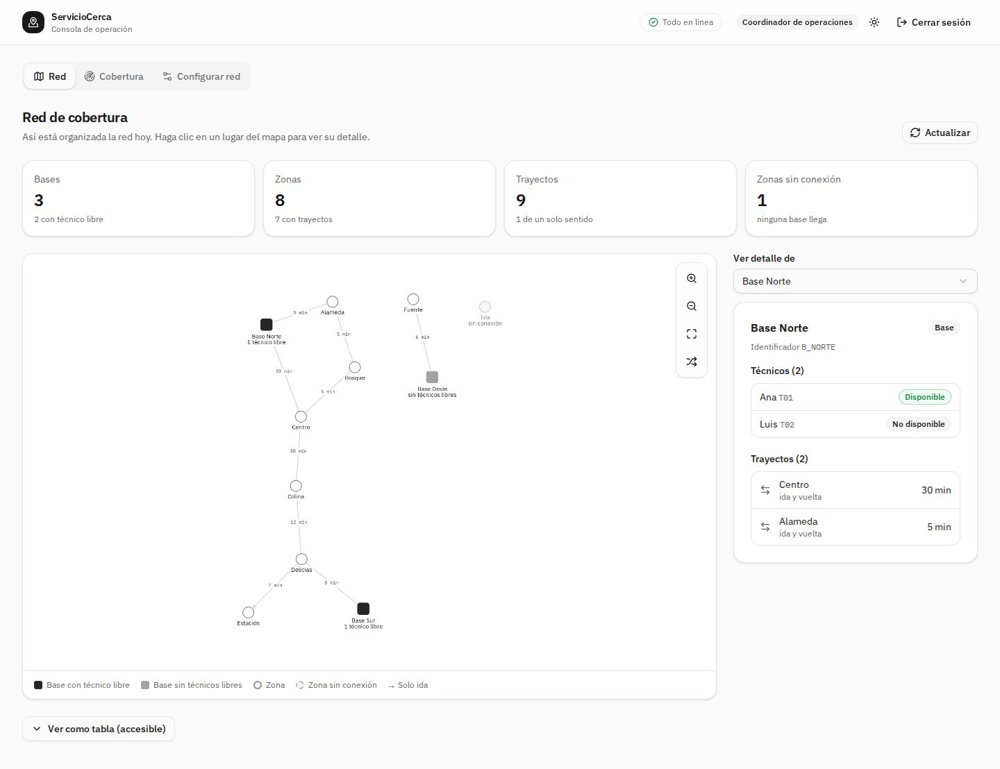
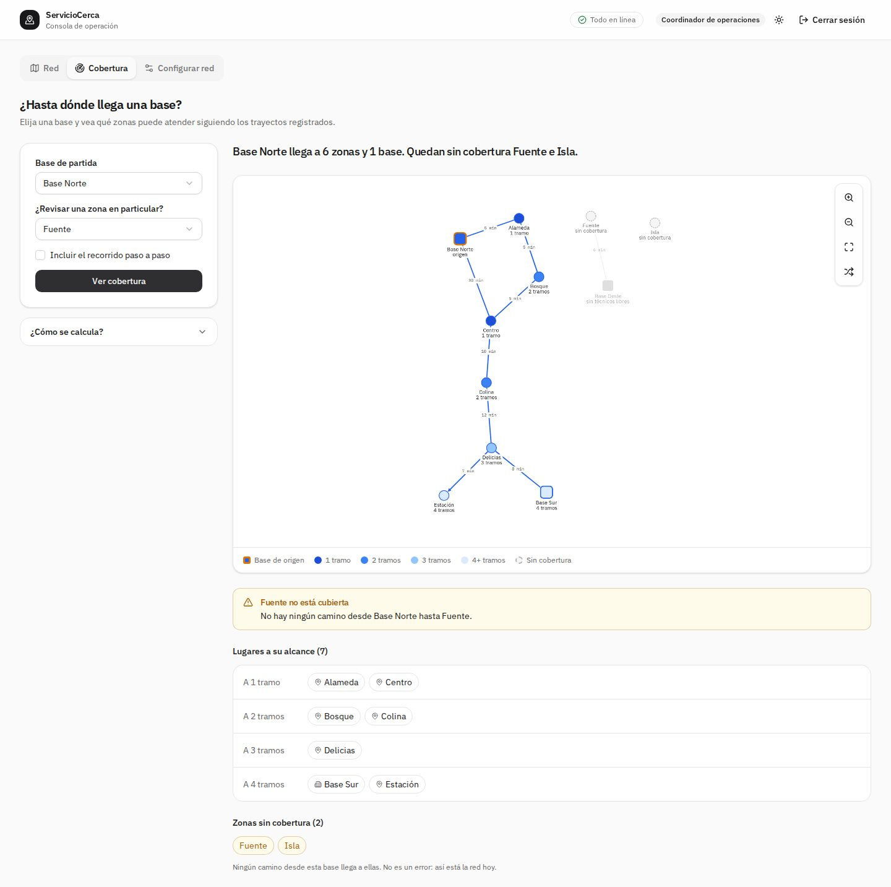
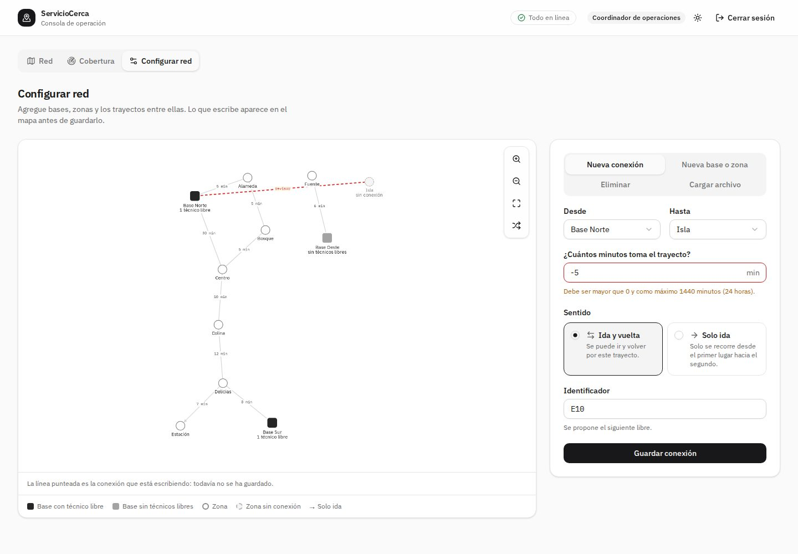
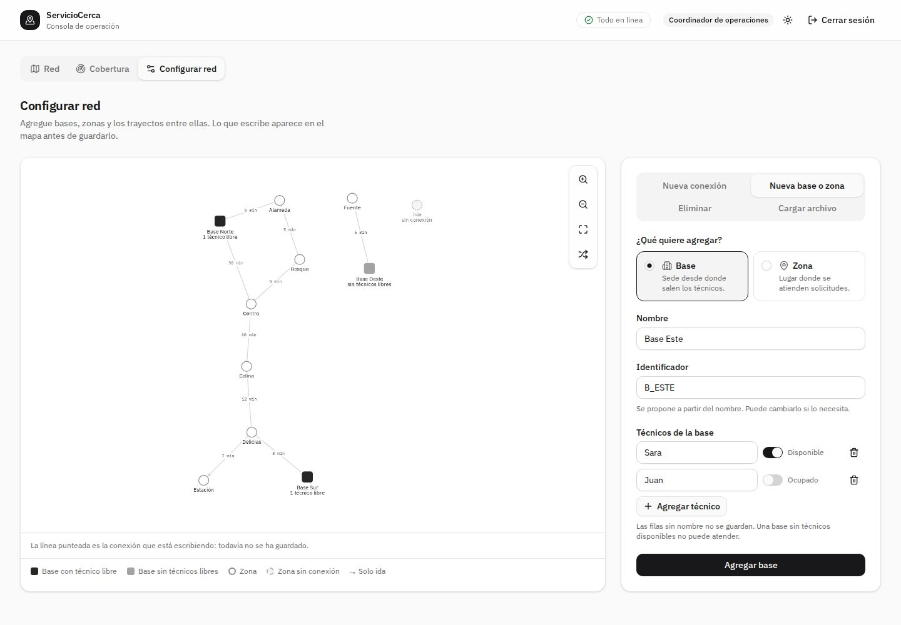
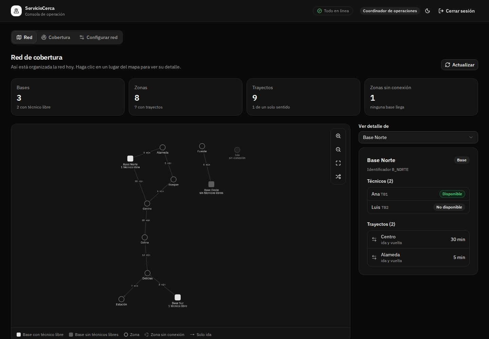
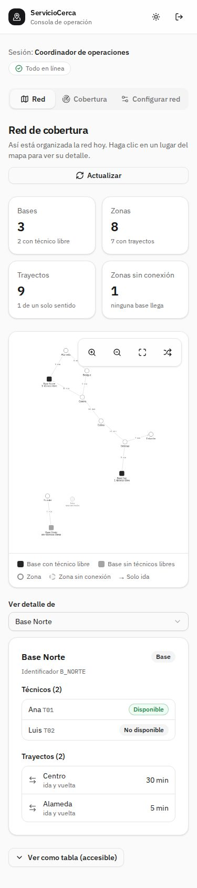

# F4 · Consola de operación demostrable

- **Servicio:** `web` (consola web, [ADR 0007](../adr/0007-consola-web-react-bff.md)) · `console` (Streamlit, en retiro) · **Dueño:** Persona 4
- **Estado:** 🟡 Consola web con paridad funcional de F1 y F2 (red, cobertura y configuración), conviviendo con Streamlit. Rutas pendientes (F3).
- **Lea antes:** [ADR 0007](../adr/0007-consola-web-react-bff.md), [03-api](../03-api.md), [06-seguridad](../06-seguridad.md#consola-web-bff-y-sesión), [10-guia-prueba-manual](../10-guia-prueba-manual.md#consola-web-react)

## Valor de negocio
El equipo de atención consulta la cobertura y la alternativa de servicio sin interpretar estructuras internas.

## Consola web (ADR 0007) — `services/web`, puerto 8080

SPA en React 19 + Vite + TypeScript, con Tailwind CSS v4, shadcn/ui (Radix), TanStack Query y Cytoscape.js. Un BFF en Hono la sirve y guarda la API key en la sesión del servidor. Streamlit sigue en `:8501` hasta que se valide la paridad con la [guía](../10-guia-prueba-manual.md#consola-web-react).

### Hecho
- [x] **Sesión:**
  - inicio de sesión con API key validada por `/auth/whoami`;
  - la clave `internal` se rechaza;
  - la clave queda en el BFF y el navegador solo recibe una cookie `HttpOnly; SameSite=Strict`;
  - si la sesión caduca (401), se vuelve al inicio de sesión.
- [x] **Estado del sistema** en lenguaje de usuario: "Todo en línea", o "Red: sin conexión" / "Consultas: sin conexión" si un servicio cae. Usa icono y texto, se actualiza cada 15 s y el nombre técnico queda en el `title`.
- [x] **Red** (ambos roles):
  - indicadores;
  - mapa interactivo: arrastrar, zoom, "Ajustar" y "Reorganizar", y hover con resumen;
  - **clic en un nodo abre su ficha** (con Streamlit no era posible: ADR 0006) y clic en el fondo quita el resaltado;
  - el mapa abre sin resaltado (toda la red visible); la ficha muestra nombre y tipo, técnicos, trayectos en palabras ("ida y vuelta", "solo ida (hacia allá)") y avisos;
  - las listas muestran nombres, no ids: el id aparece solo como dato secundario o si dos lugares se llaman igual;
  - "Ver como tabla (accesible)".
- [x] **Cobertura** (ambos roles):
  - base y zona opcional, con traza opcional ("Incluir el recorrido paso a paso");
  - **resumen en una frase**: "Base Norte llega a 6 zonas y 1 base. Quedan sin cobertura Fuente e Isla.";
  - veredicto de la zona con nombres: verde con "Centro está cubierta / Se llega desde Base Norte en 1 tramo", ámbar con "Fuente no está cubierta" (no es un error);
  - lugares alcanzados agrupados por distancia ("A 1 tramo: Alameda, Centro") y zonas sin cobertura como etiquetas;
  - "¿Cómo se calcula?" explica la regla (BFS) sin imponer la jerga;
  - **la cobertura se resalta en el mapa:** origen con anillo ámbar, nodos alcanzados coloreados por tramos con la etiqueta "N tramos", zonas sin cobertura punteadas con "sin cobertura", y el resto atenuado. Leyenda propia.
- [x] **Configurar red** (coordinador):
  - **Nueva conexión:** Desde/Hasta por nombre, minutos, sentido con tarjetas ("Ida y vuelta" / "Solo ida") e identificador propuesto (siguiente `E##` libre, editable). Tiene **vista previa** en el mapa: ámbar si es válida, rojo con "revisar" si no;
  - **Nueva base o zona:** tipo con tarjetas, nombre e **identificador sugerido** desde el nombre ("Base Este" → `B_ESTE`, editable). Los técnicos se cargan como filas con nombre e interruptor "Disponible"; sus ids (`T##`) se asignan solos;
  - **Eliminar** con confirmación: si un lugar aún tiene conexiones, se dice cuáles borrar antes y el botón queda deshabilitado;
  - **Cargar archivo:** área para soltar o elegir el `.json` y elección "Reemplazar todo" / "Agregar";
  - los avisos de éxito usan nombres ("Listo: se conectó Base Norte con Isla (12 min).").
  - Los errores se muestran con el `message` del contrato y, en una importación, con su ubicación en el archivo.
- [x] **Tema claro y oscuro** (claro, oscuro o según el sistema; se recuerda) con tokens semánticos. El mapa usa su paleta por tema.
- [x] **Diseño móvil** (375 px sin desplazamiento horizontal) y áreas táctiles de 44 px en móvil.
- [x] **Estados** de carga (esqueletos), vacío (con la siguiente acción), error (con "Reintentar") y éxito (toasts).
- [x] La pestaña activa queda en la URL (`#red`, `#cobertura`, `#configurar`).
- [x] Las posiciones del mapa se conservan al recargar la red y entre pestañas.

### Endpoints del BFF (internos de la consola; no son parte del contrato)

| Método y ruta | Qué hace |
|---|---|
| `GET /healthz` | Salud del contenedor (healthcheck de Docker) |
| `GET /bff/health` | Estado de network-service y routing-service (`/health`) |
| `GET /bff/session` | `{role}` o `{role: null}` si no hay sesión |
| `POST /bff/session` | `{api_key}` → valida con `/auth/whoami`, crea la sesión y la cookie |
| `DELETE /bff/session` | Cierra la sesión |
| `* /bff/api/network/<ruta>` | Proxy a network-service `/api/v1/<ruta>`, solo con las rutas de F1 del contrato |
| `GET /bff/api/routing/<ruta>` | Proxy a routing-service: `coverage`, `routes/cheapest` y `attention/best` |

Errores propios del BFF, con el mismo formato `{code, message, details}`:
- `FORBIDDEN` "Solicitud rechazada." (falta el encabezado anti-CSRF);
- `NOT_FOUND` (la ruta está fuera de la lista blanca);
- `SERVICE_UNAVAILABLE` "No fue posible contactar …";
- `BAD_GATEWAY` (la respuesta no es JSON);
- `PAYLOAD_TOO_LARGE` (cuerpo de más de 2 MB);
- `INTERNAL_ERROR`.

Variables del contenedor (las fija `docker-compose.yml`; no van en `.env`):

| Variable | Por omisión |
|---|---|
| `NETWORK_SERVICE_URL` | obligatoria |
| `ROUTING_SERVICE_URL` | obligatoria |
| `PORT` | `8080` |
| `REQUEST_TIMEOUT_MS` | `5000` |
| `SESSION_TTL_MINUTES` | `480`, con caducidad deslizante |
| `COOKIE_SECURE` | `false`; `true` detrás de HTTPS |
| `STATIC_DIR` | `./dist/client` |

## Hecho en Fase 0
- [x] Inicio de sesión con API key: el rol se obtiene de `/auth/whoami` y la clave `internal` se rechaza.
- [x] Panel de estado de los servicios, con mensaje legible si un servicio está caído.
- [x] Clientes HTTP con traducción de errores del contrato (`ApiClientError`).

## Hecho en F1-D (interfaz mínima de la red)
- [x] Sección **Red** (ambos roles): tablas de nodos con técnicos y de conexiones con peso y sentido, botón "Actualizar".
- [x] Pestaña **Configurar red** (coordinador): registrar base o zona con técnicos, registrar conexión, eliminar nodo o conexión y cargar un JSON con `/network/import`.
- [x] Errores con el `message` del contrato (p. ej. `INVALID_WEIGHT`). Detalle: [F1-D](F1D-integracion.md).

## Hecho en la consola visual ([ADR 0006](../adr/0006-grafo-pyvis-embebido-seguro.md))
- [x] **Tema claro** (`.streamlit/config.toml`): fondo `#F4F7FB`, primario `#1F5FBF`, texto `#0F2540`.
- [x] **Mapa interactivo** de la red con pyvis (vis-network 9.1.2):
  - arrastrar nodos, zoom con rueda y botones, "Ajustar" y "Reorganizar" con animación;
  - hover con resumen; clic para resaltar los trayectos de un nodo y atenuar el resto.
- [x] **Red** (ambos roles):
  - indicadores (bases, zonas, trayectos, zonas sin conexión);
  - ficha del nodo: técnicos con su disponibilidad, trayectos y avisos (base sin técnicos libres, zona sin conexión);
  - tablas como respaldo accesible en "Ver como tabla".
- [x] **Configurar red** (coordinador): el mapa dibuja como **vista previa** la conexión que se está escribiendo (punteada en ámbar, o en rojo con "revisar" si el peso está fuera de rango) junto a la acción elegida.
- [x] Seguridad del embebido:
  - iframe con origen opaco (`data:`);
  - CSP sin red y con `script-src` por hash;
  - datos con `tojson`;
  - nombres escapados en Markdown;
  - pruebas en `tests/test_graph_view.py`.

## Sistema visual

### Consola web: neutra en blanco y grises (2026-10-28)

La interfaz es neutra y **el color solo aparece cuando comunica algo**: selección y cobertura en azul, vista previa y avisos en ámbar, errores en rojo y éxito en verde. Así el resultado de una consulta resalta sin competir con el resto de la pantalla.

Los tokens viven en `services/web/src/index.css` (`:root` y `.dark`) y la paleta del mapa en `services/web/src/lib/graph-elements.ts` (`LIGHT_PALETTE` y `DARK_PALETTE`).

| Rol | Claro | Oscuro | Uso |
|---|---|---|---|
| Fondo / superficie | `#FAFAFA` / `#FFFFFF` | `#0A0A0A` / `#141414` | Página y tarjetas |
| Texto / secundario | `#171717` / `#646464` | `#FAFAFA` / `#A3A3A3` | Texto (contraste AA sobre el fondo) |
| Primario | `#18181B` | `#FAFAFA` | Botón de la acción principal |
| Bordes | `#E5E5E5` | `#2A2A2A` | Tarjetas, tablas y campos |
| Base con / sin técnico libre | `#262626` / `#A3A3A3` | `#E5E5E5` / `#5C5C5C` | Cuadrados del mapa |
| Zona | blanco con borde `#8A8A8A` | `#141414` con borde `#8A8A8A` | Círculos del mapa |
| Trayecto en reposo | `#D4D4D4` | `#3D3D3D` | Aristas |
| Azul (selección y cobertura) | `#2563EB`; tramos `#1D4ED8` → `#DBEAFE` | `#60A5FA`; tramos `#93C5FD` → `#1E40AF` | Lo seleccionado, lo alcanzado y el origen |
| Ámbar | `#D97706` | `#FBBF24` | Anillo de origen, vista previa sin guardar, zonas sin cobertura |
| Rojo | `#DC2626` | `#F87171` | Vista previa inválida, errores |

Cada nodo de la cobertura lleva además el texto "N tramos", "origen" o "sin cobertura", así que nada depende solo del color.

### Consola Streamlit (en retiro)

Propuesta de diseño: lienzo "ServicioCerca · Consola visual" (artefacto privado del equipo).

| Rol | Color | Uso |
|---|---|---|
| Fondo / superficie | `#F4F7FB` / `#FFFFFF` | Lienzo y tarjetas |
| Tinta / secundario | `#0F2540` / `#4A5D78` | Texto (15,6:1 y 6,6:1 sobre blanco) |
| Azul primario | `#1F5FBF` | Bases con técnico libre, acciones, trayectos resaltados |
| Azul zona | `#DCEBFB` + borde `#5B8FD6` | Zonas |
| Azul trayecto | `#8FA9CC` | Aristas en reposo |
| Base sin técnicos libres | `#8CA3C3` | Mismo glifo, menos saturado |
| Ámbar / ámbar fuerte | `#F2B661` / `#E08A1E` | Selección; vista previa sin guardar |
| Rojo error | `#B42318` | Vista previa inválida |
| Gris inactivo | `#9AA8BA` (borde punteado) | Zona sin conexión |

**Teoría del color:**
- Los **azules análogos** dan calma y estructura.
- El **ámbar es complementario** del azul: solo marca lo que requiere atención.
- Los estados que hay que distinguir difieren también en **luminosidad**, no solo en tono, para que se distingan aunque se confundan los colores.

**Codificación sin leer:**
- forma = tipo (cuadrado base, círculo zona);
- borde punteado = sin conexión;
- longitud de la arista = minutos;
- flecha = solo ida.

## Criterios de aceptación (Fases 1 a 3)
- [x] **Coordinador:** formularios para registrar bases (con técnicos), zonas y conexiones; botón para cargar la red demo (`/network/import`); mensajes de validación legibles.
- [ ] **Operador:** consulta de cobertura (base y zona opcional) ✅, ruta de menor costo (origen y destino) y mejor atención (zona), estas dos pendientes de F3.
- [ ] **Visualización** (pyvis):
  - [x] bases y zonas diferenciadas;
  - [x] aristas con peso y dirección;
  - [x] cobertura resaltada: nodos alcanzados y no alcanzados (consola web);
  - [ ] ruta resaltada, y el camino de menos tramos en un estilo distinto (F3).
- [ ] Explicación en lenguaje natural del resultado (`message`) y traza opcional en un desplegable: hecho para cobertura; falta F3.
- [ ] Aceptación de: éxito, zona inexistente, red desconectada y peso inválido.
- [ ] Incorporar el **cambio de requisito docente** (Fase 4, por definir).
- [ ] Evidencia completa de la feature (capturas por escenario).

## Cambio de requisito docente
_Por definir. Registrar aquí el requisito, el ADR asociado y su impacto cuando se conozca._

## Evidencia (Fase 3)

Consola visual (2026-10-07):

| Red: Base Norte seleccionada (sus trayectos en azul, el resto atenuado) | Configurar red: vista previa con peso `-5` ("revisar") |
|---|---|
|  |  |

Consola web (2026-10-28, Chromium vía Playwright, red demo):

| Inicio de sesión | Red: mapa completo y detalle de Base Norte | Cobertura desde Base Norte, zona Fuente |
|---|---|---|
|  |  |  |

| Nueva conexión con peso `-5`: vista previa "revisar" | Nueva base con técnicos e id sugerido | Tema oscuro | Móvil (375 px) |
|---|---|---|---|
|  |  |  |  |

En el navegador no hubo errores de JavaScript ni violaciones de CSP.

Pendiente: capturas de los escenarios de ruta (F3).
